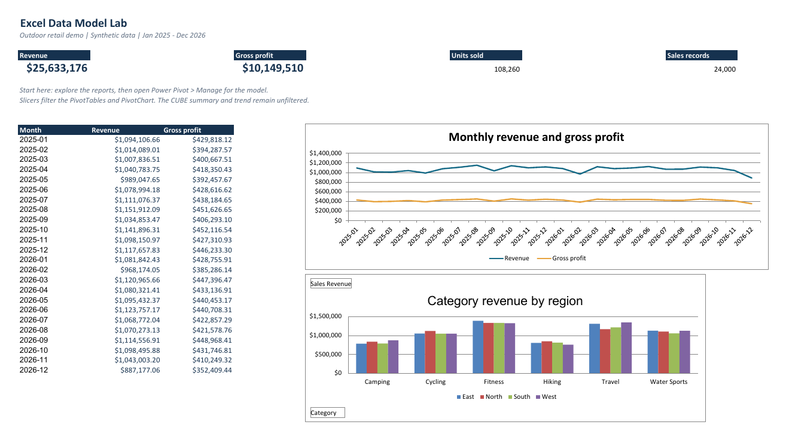
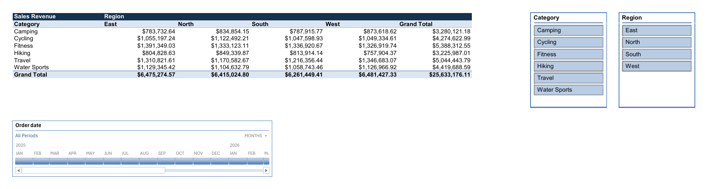
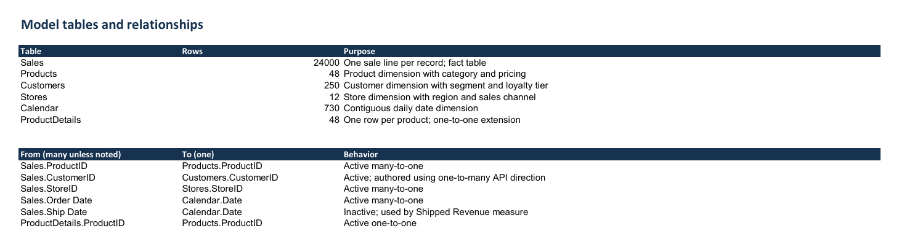

# Excel Data Model Lab

**Create and edit Excel Power Pivot data models from Python, without Excel installed.**

Build tables, relationships, DAX measure definitions, and model-backed PivotTables
and charts in `.xlsx` files. Source records can live entirely inside the embedded
Data Model; worksheet copies are optional.

[Install from PyPI](https://pypi.org/project/excel-data-model-lab/) ·
[Download the demo workbook](https://github.com/sean-palmer-coding/excel-data-model-lab/releases/download/v0.5.0rc2/Excel-Data-Model-Lab-Demo.xlsx) ·
[API documentation](SOURCE_AND_DEPENDENCY_API.md) ·
[Report an issue](https://github.com/sean-palmer-coding/excel-data-model-lab/issues)



## Install

Python 3.10 or newer. The current release is **0.5.0rc2**, an early release candidate.

```bash
python -m pip install excel-data-model-lab==0.5.0rc2
```

Imports remain `excel_model_lab` and `excelmodel`. If you previously installed the
old `excel-model-lab` distribution, uninstall it before switching to avoid
shared package files.

## Quick start

Create two related tables and a revenue PivotTable. No source-data worksheets,
Excel installation, COM, or remote model are required to author this file.

```python
import pandas as pd
from excel_model_lab import WorkbookModel, WorkbookReport, PivotTableSpec

products = pd.DataFrame({
    "ProductID": [1, 2, 3],
    "Category": ["Camping", "Cycling", "Hiking"],
})
sales = pd.DataFrame({
    "ProductID": [1, 2, 1, 3, 2],
    "Revenue": [120, 300, 80, 150, 200],
})
model = WorkbookModel.create({"Sales": sales, "Products": products})
model.add_relationship("Sales", "ProductID", "Products", "ProductID")
model.add_measure("Sales", "Total Revenue", "SUM(Sales[Revenue])",
                  format_string="$#,##0.00")

report = WorkbookReport(model)
report.add_pivot_table(PivotTableSpec(
    "RevenueByCategory", "Category Report",
    rows=(("Products", "Category"),), measures=("Total Revenue",),
))
report.save("sales-report.xlsx")
```

[Runnable script](examples/quickstart.py). Expected revenues are Camping **200**,
Cycling **500**, Hiking **150**, and total **850**.

**Excel calculates and renders the reports.** A freshly authored PivotTable may
need an initial layout update: select its anchor cell, check **Defer Layout
Update** in the PivotTable Fields pane, then click **Update**. Ordinary Refresh
may leave a fresh layout blank. See [first-use instructions](docs/phase2-reports.md#first-use-in-desktop-excel)
or the optional [Windows update helper](tools/update_model_reports.ps1).

## Explore the demo

[Download the ready-to-explore workbook](https://github.com/sean-palmer-coding/excel-data-model-lab/releases/download/v0.5.0rc2/Excel-Data-Model-Lab-Demo.xlsx)
(about 3.3 MB). It contains synthetic outdoor-retail data, with no external data
source required. The model and reports have already been calculated and saved
in desktop Excel, then verified after reopening.

- 24,000 sales across two years, six model tables and six relationships.
- 11 measures, seven calculated columns, a KPI, three hierarchies and two perspectives.
- Three PivotTables, a PivotChart, an ordinary chart, two slicers and a timeline.
- CUBE formula examples, source snapshots, an independent Checks tab and a Feature Guide.

Start on **Dashboard**, then open **Feature Guide** and **Model Map**.
Use **Power Pivot > Manage** to inspect the embedded model. The data-sheet copies
are for inspection; editing them does not automatically update the model.



<details>
<summary>View the demo's tables and relationships</summary>



</details>

## Scope and verification

The core writer is headless. Desktop Excel is used for native compatibility
verification, report calculation/rendering, and the optional `desktop` extra.
The library also supports workbook composition, CUBE formula helpers, bounded
DAX evaluation, external semantic connections/query adapters, and desktop/agent
workflows. It is not a complete headless Excel or DAX engine.

**865 local tests passed, with 50 expected historical-fixture skips**, plus native
Excel related-table query/save/reopen verification for rc2. See
[rc2 acceptance](docs/rc2-acceptance.md), [report capabilities](docs/phase2-reports.md),
and [current limitations](STATUS.md). Cloud authentication and external-model
PivotTable generation remain outside the verified scope. Historical CI results
apply to their documented checkpoints; current release checks run locally.

Compatibility feedback is welcome. When reporting a problem, include the package,
Python and Excel versions, the error, and a minimal synthetic reproducer.

## Python API

```python
from excelmodel import WorkbookModel

workbook = WorkbookModel.from_template("template.xlsx")
workbook.replace_tables({
    "Claims": claims_df,
    "Providers": providers_df,
})
workbook.add_relationship(
    "Claims", "ProviderID", "Providers", "ProviderID"
)
workbook.add_measure(
    "Claims",
    "Total Charges",
    "SUM('Claims'[ChargeAmount])",
    format_string="$#,##0.00",
)
workbook.save("report.xlsx")
```

Create a model without supplying a template:

```python
from excel_model_lab import WorkbookModel

model = WorkbookModel.create({"Products": products_df, "Sales": sales_df})
model.add_column("Products", "Rank", [3, 2, 1])
model.set_sort_column("Products", "Category", "Rank")
model.add_hierarchy("Products", "Catalog", ["Category", "ProductID"])
model.add_relationship("Sales", "ProductID", "Products", "ProductID")
model.save("created.xlsx")
```

The example expects three product rows. Pass `workbook="ordinary.xlsx"` to
`create` to preserve an existing workbook's worksheets while inserting a model.
`add_table` accepts an independent dataframe. `rename_table`, `remove_table`,
`rename_column`, `remove_column`, `change_column_type`, `configure_table` and
`configure_column` cover schema and display edits. Dependency guards reject
unsupported changes involving existing calculations or presentation objects.

Hierarchies support `update_hierarchy`, `configure_hierarchy` and
`remove_hierarchy`. Pass the displayed hierarchy name, even when a native
workbook uses a different internal identifier. Relationships support `set_relationship_active` and
`remove_relationship`. `set_sort_column(..., by=None)` restores default ordering.
DAX calculation-engine work is separate; existing measure-writing support remains.

`to_bytes()` is intended for web responses:

```python
payload = workbook.to_bytes()
```

Every save is independently reopened with PBIXRay by default. Requested values,
row counts, measures, existing relationships, and new relationships are checked
before the generated path is returned. Pass `validate=False` only when an
application has its own validation boundary.

## Model as code

```yaml
tables:
  Claims:
    source: data/claims.csv
  Providers:
    source: data/providers.parquet
relationships:
  - from: Claims.ProviderID
    to: Providers.ProviderID
measures:
  - table: Claims
    name: Total Charges
    expression: SUM('Claims'[ChargeAmount])
    format: "$#,##0.00"
    display_folder: Finance
```

Build it with paths resolved relative to the specification:

```bash
excelmodel build template.xlsx report.xlsx model.yaml
```

Create from a specification with no template:

```bash
excelmodel create report.xlsx model.yaml
excelmodel create report.xlsx model.yaml --workbook ordinary.xlsx
```

`build` replaces named existing tables and adds new table names. CSV definitions
can include `read_options` forwarded to Pandas (for example `dtype` or
`parse_dates`). Install `excel-data-model-lab[parquet]` for Parquet input. Table
definitions can also contain `hidden`, `description`, `columns` (per-column
`hidden`, `description`, `format`, `sort_by`) and `hierarchies` (`name`, `levels`,
optional `hidden`, `description`, `level_names`). Paths are relative to the spec.

## Supported model data

### KPIs and calculation-area visibility

Create a three-state, higher-is-better KPI using an existing target measure:

```python
model.add_kpi("Sales", "Total Amount", target_measure="Target Amount",
              lower=0.4, upper=0.8)
print(model.list_kpis())
model.update_kpi("Sales", "Total Amount", target_measure="Target Amount",
                 lower=0.5, upper=0.95)
model.remove_kpi("Sales", "Total Amount")  # Retains both user measures.
model.update_measure("Sales", "Target Amount", expression="120", format_string="0")
# Independent measures can also be removed with model.remove_measure(table, name).
```

The example uses percentage thresholds. KPIs also support fixed targets,
absolute thresholds, ascending/descending and centered modes, and multiple native
icon sets. See [the KPI guide](docs/CALCULATED_COLUMNS_AND_KPIS.md) for supported
combinations. The API writes native metadata and helper formulas; it does not
evaluate DAX. Newly visible measures receive separate
calculation-area rows; existing saved measure positions are retained.
Measure removal rejects calculation and existing PivotTable dependencies;
remove a base measure's KPI before editing that base measure. Measure names
must be unique across the model, ignoring case.

- Existing tables can be replaced individually or atomically as a group.
- Row counts can shrink or grow.
- Integer, real, Currency, Date, nullable numeric, and dictionary-encoded string
  columns are supported for the tested template encodings.
- Pure bit-packed, hybrid RLE, and multi-segment IDF data are regenerated.
- String and numeric dictionaries and numeric hash indexes are regenerated.
- DAX measures can include format strings, display folders, and descriptions.
- Active and inactive many-to-one relationships can be added.
- Untouched XLSX members and unknown ABF virtual files are preserved.
- Output remains a normal, self-contained `.xlsx` package.

Use schema inspection before selecting a template:

```bash
excelmodel schema template.xlsx
excelmodel inspect template.xlsx --semantic
```

## Compatibility boundaries

A full table replacement must provide every non-engine column in that table.
Creating new models uses a bundled synthetic seed; no caller-supplied template
is required. Existing workbook presentation parts are preserved, and unsupported
schema changes with presentation dependencies are rejected.

The current authoring backend has limits: new stored column identifiers are
restricted. Text dictionary ordering supports pinned en-US/en-GB collation;
unsupported locales and codepoints are rejected. Numeric dictionaries support
values beyond the arithmetic encoding's signed 32-bit ID span. The supported
authoring range is `-9223372036854775807` through `9223372036854775806` for integers
and `-922337203685477.5807` through `922337203685477.5806` for Currency, inclusive.
The immediately adjacent signed64 endpoints are rejected after native aggregate
failures; existing endpoint values remain readable. Isolated native DAX queries
returned exact aggregates for the supported boundaries. New datetime columns support
timezone-naive values through whole seconds. Subsecond values are rejected.
The independent reader's floating-point date artifacts are normalized only to
the whole-second grid declared by value-encoding metadata. Empty tables use native
zero-row storage; use `replace_table` to populate all their columns together.
The integrated API's create/populate/clear outputs pass desktop Power Pivot
acceptance. Unrecognized storage layouts are rejected rather than rewritten
speculatively. Combined native load, calculation, filtering, hierarchy and
reopen checks pass, including tiny dictionaries and nullable numeric lifecycles.

External data connections are preserved as package content. The API can author
Excel-native linked-table and OLE DB source bindings, but does not execute Excel's
refresh engine. Linked-table refresh has passed a native test; SQL Server two-source refresh, rebind, detach and save/reopen have passed native
checks using authorized credentials supplied through Excel data APIs. The public
writer rejects embedded passwords; it does not manage Excel session credentials. Enabling an old
workbook's external refresh can replace stored values from its original source.

### Refreshing stored data through Python

Use `refresh_sources` to read CSV, Parquet, or a parameterized SQL query into
existing tables. All sources are read and checked before any table update is
applied. Each source must supply every stored column in its target table.

```python
from excel_model_lab import WorkbookModel, CsvSource, ParquetSource, SqlSource

model = WorkbookModel("model.xlsx")
model.refresh_sources({
    "Sales": CsvSource("sales.csv"),
    "Products": ParquetSource("products.parquet"),
})
print(model.tables)
print(model.get_table("Sales"))
model.save("refreshed.xlsx")

# With a caller-owned SQLite or SQLAlchemy connection:
# model.refresh_sources({"Sales": SqlSource(connection,
#     "SELECT * FROM sales WHERE year = :year", params={"year": 2026})})
```

Parquet requires the optional `parquet` dependency. Readers accept
`read_options` for pandas options such as CSV dtypes. SQL connections remain
owned by the caller. Source paths, connection credentials, and query bindings
are not saved as workbook refresh connections. This method reads stored data;
it does not evaluate DAX.

Workbook presentation layout authoring, a DAX engine, universal historical
VertiPaq/encrypted-workbook compatibility, and `.xls`/`.xlsb`/VBA authoring are
outside this work. Unsupported encodings fail before committing the destination.
Independent decoder validation does not replace desktop Excel acceptance.

## Development

```bash
python -m pip install -e .
python -m pytest -q
python -m build
```

Low-level laboratory commands remain available under `excelmodel --help` for ABF
inventory, extraction, cloning, diffing, and controlled IDF mutation.

### Explicit relationship cardinality

`add_relationship(..., cardinality="many-to-one")` retains the existing default.
Use `one-to-many` to supply the lookup end first; the API normalizes the stored
endpoints to many-to-one. Removal/activation use these normalized endpoints.
Use `one-to-one` to require unique keys at both ends and write One/One metadata.
Explicit One/One metadata passed native save/reopen acceptance.

Invalid cardinality, duplicate keys, type mismatches and invalid active paths
raise `RelationshipValidationError`, a `ValueError` subclass. Duplicate errors
include the table, column, value and one-based data row positions. Missing
columns retain `KeyError`. Checks run at definition and again before saving
changed relationship keys, even when `save(validate=False)` is used. Activation
changes retain cardinality. Validation does not require every foreign key to
match: unmatched rows retain Excel's blank-member behavior.

Blank lookup keys remain an implementation limitation (`UnsupportedModelError`),
not a claim that Excel rejects every blank. Text keys use Windows en-US linguistic comparison when available; other locales
and equivalent distinct spellings within a dictionary remain guarded.

## Read-only inspection and streaming

The reader does not initialize the writer or require write-compatible encodings.
It delegates to the pinned PBIXRay 0.15.5 public API. It supports the formats that
PBIXRay supports (XLSX/PBIX/ABF); this does not add PBIX/ABF writing. Excel fixture
parity and resource lifecycle are tested here; broad format coverage comes from
PBIXRay rather than a new independent compatibility certification.

```python
from excel_model_lab import WorkbookModel

with WorkbookModel.open("report.xlsx", on_disk=True) as reader:
    print(reader.tables)
    print(reader.schema)
    print(reader.relationships)
    print(reader.dax_measures)
    print(reader.mashup_queries)
    for chunk in reader.iter_table("Sales", columns=["Amount"], chunk_size=10000):
        process(chunk)
```

`ModelReader` is also directly importable. All public PBIXRay metadata properties
are exposed, including `connections`, `data_mashup`, `perspectives`, `statistics`
and the `tmschema_*` properties. Availability and empty results depend on the
source format. Processed model values normalize declared/inferred types, preserving Currency as
Decimal and calculated dates, booleans and integers. Upstream format limitations remain. Keep the reader open while consuming
an iterator. Closing it releases resources; materialized DataFrames remain usable.

For editing, use `WorkbookModel.open("report.xlsx", read_only=False)` or the
existing constructor. Readers show the saved source, not another editor's staged
changes. Writer `get_table()` continues to include its staged data changes.

## Preflight validation

```python
model = WorkbookModel.open("report.xlsx", read_only=False)
report = model.validate()
for issue in report.issues:
    print(issue.severity, issue.code, issue.message)
report.raise_for_errors()
```

Current checks cover relationship key uniqueness, type compatibility, duplicate
relationships, self-links and ambiguous active paths, plus warnings for columns
outside the writer's supported encodings. Pending measure-name conflicts are also
reported before saving. This is not complete formula/dependency
validation, DAX evaluation or proof of native Excel compatibility. Existing
save-time checks remain in place. Report validity means no errors in these checks.


## Unicode and locale contract

String dictionary and relationship comparison supports pinned en-US and en-GB
collation. Windows uses NLS; the packaged portable tables provide the supported
comparison behavior on Linux, including tested Japanese context and Jamo cases.
Unsupported locales or codepoints fail explicitly. Actual macOS validation is
still pending. Equivalent distinct dictionary spellings are rejected rather than
silently rewritten; matching keys in different tables may compare equal.
Embedded NUL characters are rejected.

Native Unicode table rows and relationship filtering passed save/reopen checks.
See [STATUS.md](STATUS.md) and the native acceptance ledger for tested grouping,
dictionary layouts and platform boundaries.

## Calculated columns and date keys

```python
model.add_calculated_column("Sales", "Double Amount", "[Amount] * 2",
                            data_type="currency")
model.update_calculated_column("Sales", "Double Amount", "[Amount] * 3",
                               data_type="currency")
model.remove_calculated_column("Sales", "Double Amount")
```

Explicit types are `integer`, `decimal`, `currency`, `datetime`, `boolean` and
`text`. Definitions are stored with unprocessed caches; Excel performs DAX
calculation. The library does not invent calculated results. All six explicit
types and calculated resizing/empty-table lifecycles passed native processing
and save/reopen checks. Calculated relationships and stored-column sorting by calculated keys passed
native processing/save/reopen, including changed inputs and dependent hierarchy
checks. Final combined regression and local artifact verification passed; see
[STATUS.md](STATUS.md) for the recorded results.

`mark_date_table(table, column)` requires a nonempty stored datetime column with
unique, nonblank, contiguous whole dates. `unmark_date_table(table)` restores the
internal row key. Stored date marking passed native processing/save/reopen.
Calculated date keys remain explicitly unsupported: a processed same-table
computed date key failed native processing with a circular dependency. This is
a documented limitation, not a claim that every DAX expression is forbidden by
all Excel versions. Pending values cannot establish uniqueness or contiguity.
